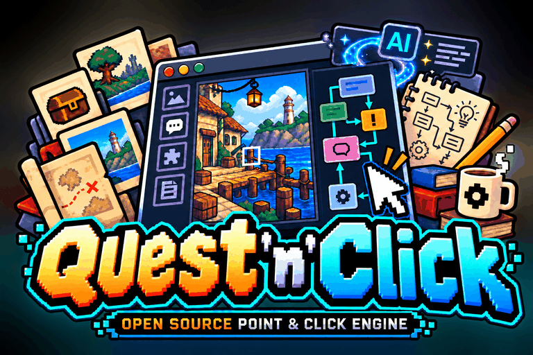

<p align="center"></p>

# quest'n'click

**Faire un point-and-click pour le navigateur : l'écrire comme des données, le façonner dans un Studio visuel,
vérifier qu'on peut le finir, et le livrer comme un jeu web qui s'installe sur un téléphone et se joue hors ligne.**

*[English version](README.md)*

> **Anciennement web-scumm.** Ce projet s'appelait WebSCUMM, puis web-scumm, en hommage à SCUMM, le moteur de
> LucasArts dont il suit l'esprit. Il a été renommé quest'n'click pour que son nom ne suscite aucun débat inutile. Les
> liens vers l'ancien dépôt sont redirigés ici, et l'ancienne adresse de la démo, `wanoo.github.io/web-scumm`, redirige
> vers la nouvelle : le jeu et le Studio sont maintenant sur [quest-n-click.cleverapps.io/demo](https://quest-n-click.cleverapps.io/demo/).
> À partir de la 4.2.5, les packages et les commandes s'appellent `quest-n-click` ; les anciens noms `web-scumm` ont
> marché pendant toute la 4.2.x et disparaissent en 4.3.0, où `npx quest-n-click migrate` renomme les imports et les
> commandes d'un jeu ([notes de mise à jour](https://github.com/Quest-n-Click/quest-n-click/wiki/FR-Installer-Notes-Mise-A-Jour-4-3#from-4-2-5-to-4-3-0)).
> À partir de la 4.5.2, les packages sont nommés sous le scope de l'organisation npm, `@quest-n-click/engine`,
> `@quest-n-click/create`… (les commandes gardent leur nom), et `npx quest-n-click migrate` passe les imports
> `quest-n-click/…` d'un jeu à `@quest-n-click/engine/…`. Les sauvegardes, les runs et les sessions gardent leurs
> formats et se chargent comme avant.

| | |
|---|---|
| 🎮 **Jouer** | [La Clé du garde-manger](https://quest-n-click.cleverapps.io/demo/), le jeu d'exemple, sur téléphone en paysage ou sur ordinateur |
| 🛠 **Studio** | [Ouvrir le Studio](https://quest-n-click.cleverapps.io/demo/studio.html) en mode démo : modifiez le jeu d'exemple, vos modifications restent dans votre navigateur |
| ⏱ **Commencer** | [Votre jeu dans son propre dossier](#commencer), puis [une première pièce en quinze minutes](https://github.com/Quest-n-Click/quest-n-click/wiki/FR-Creer-Premier-Jeu) |


## Commencer

<!-- install:begin -->
Node 22.12 ou plus récent et Python 3 avec Pillow (`npm run assets` prépare les images avec eux), sous Windows, macOS
ou Linux. Le moteur s'installe depuis l'archive d'une release, ou depuis npm à partir de la 4.5.2 (chaque release y
est une fois approuvée par un propriétaire) :

```bash
T=https://github.com/Quest-n-Click/quest-n-click/releases/download/v4.5.3/quest-n-click-4.5.3.tgz
npx --package=$T quest-n-click create mon-jeu "Mon jeu" --engine=$T
cd mon-jeu && npm install
npm run assets && npm run dev        # y jouer ; puis npm run verify, npm run build
```
<!-- install:end -->

Depuis npm, `npm init @quest-n-click my-game` crée le projet en une commande
([Installer depuis npm](https://github.com/Quest-n-Click/quest-n-click/wiki/FR-Installer-Depuis-NPM)).

`npm run build` écrit `dist/`, un site statique que n'importe quel hébergement sert. ffmpeg sert au pipeline sonore
et reste optionnel ; `npx quest-n-click doctor` dit ce qui manque. [Référence du paquet](https://github.com/Quest-n-Click/quest-n-click/wiki/FR-Installer-Paquet)
est le guide complet ; le [Votre premier jeu](https://github.com/Quest-n-Click/quest-n-click/wiki/FR-Creer-Premier-Jeu) accompagne la première pièce.
Avant la 4.2.5, l'archive et la commande s'appelaient `web-scumm` ; la 4.2.5 les livrait aussi sous ce nom, la 4.3.0
ne le fait plus : un jeu fait avant passe avec `npx quest-n-click migrate` ([notes de mise à jour](https://github.com/Quest-n-Click/quest-n-click/wiki/FR-Installer-Notes-Mise-A-Jour-4-3#from-4-2-5-to-4-3-0)).

## Fabriquer un jeu

**Le contenu, ce sont des données.** Pièces, accessoires à états, personnages, objets, règles, conversations,
indices, scripts et événements sont de simples objets TypeScript, sans code dedans : chaque outil peut les lire, les
vérifier et les jouer.

```ts
export const garden: RoomDef = {
  id: 'garden', name: 'The garden', decor: 'garden',
  props: { tank: { name: 'water tank', states: { full: 'tank_full', empty: 'tank_empty' } } },
  exits: { back_door: { name: 'back door', to: 'house', entry: 'garden' } },
  on: [
    { verb: 'use', a: 'pipe', b: 'tank', if: '!tank_drained',
      do: [{ minigame: 'pipes' }, { lose: 'pipe' }, { set: 'tank_drained' }, { prop: ['tank', 'empty'] }] },
  ],
  hints: [{ until: 'tank_drained', lines: ['Use the pipe on the water tank.'] }],
};
```

Une règle, c'est un verbe, une cible, une condition et une liste de commandes. Ce qu'un jeu demande au-delà, une
commande à lui, est du TypeScript propre au jeu : du code de confiance, nommé dans le jeu et pris dans son empreinte
([principes du contenu](https://github.com/Quest-n-Click/quest-n-click/wiki/FR-Creer-Principes), [fonctionnement du moteur](https://github.com/Quest-n-Click/quest-n-click/wiki/FR-Moteur-Fonctionnement)). Des mécaniques célèbres du genre sont
écrites ainsi dans [Mécaniques classiques](https://github.com/Quest-n-Click/quest-n-click/wiki/FR-Creer-Mecaniques-Classiques).

**Le Studio, c'est le vrai moteur avec un éditeur par-dessus** : les pièces et leurs placements, le storyboard case par
case, chaque planche de sprites et où elle sert, les vérifications après chaque sauvegarde, un onglet de jeu qui
explique une règle et rejoue une session, et des notes partagées avec un assistant IA ([le Studio](https://github.com/Quest-n-Click/quest-n-click/wiki/FR-Studio-Presentation)).

<table>
<tr><td width="50%" valign="top"><br><sub><b>Pièces</b> : le vrai moteur, un éditeur de placement par-dessus, chaque réplique modifiable sur place</sub></td><td width="50%" valign="top"><br><sub><b>Vérifier</b> : le validateur et le solveur, relancés après chaque sauvegarde</sub></td></tr>
</table>

**Images, son et langues.** Un prompt pour chaque planche de sprites, objet et décor dans un seul style, des planches
découpées en sprites ([Images](https://github.com/Quest-n-Click/quest-n-click/wiki/FR-Creer-Images)) ; une musique chiptune arrangée depuis un MIDI et des bruitages
tirés d'une même palette ([Musique](https://github.com/Quest-n-Click/quest-n-click/wiki/FR-Creer-Musique)) ; chaque réplique traduisible, une traduction manquante trouvée
avant la release.

## Le prouver et le livrer

- **Validé** : les références cassées, les pièces inatteignables et les répliques non traduites sont trouvées avant
  que quiconque joue.
- **Résolu** : le solveur fait tourner le vrai moteur (pas de second modèle du contenu). `npm run verify` demande un
  **témoin**, un chemin vers une fin ; `npx quest-n-click solve --prove` explore **chaque état atteignable** et échoue sur un blocage ou une
  recherche tronquée. Ce sont deux promesses différentes, et la release demande la seconde ([Mesures de performance](https://github.com/Quest-n-Click/quest-n-click/wiki/FR-Contribuer-Mesures-De-Performance)
  dit ce que la preuve peut et ne peut pas faire).
- **Rejoué** : une session est l'unité de reproduction ; les sauvegardes se chargent d'une version à l'autre, une
  sauvegarde figée par release depuis la 3.0.0.
- **Livré** : une PWA qui s'installe et se joue hors ligne après la première visite, ce qu'un téléphone doit
  télécharger tenu par un budget, chaque fichier compté avec sa licence.
- **Accessible autant qu'une machine peut le dire** : axe-core sur chaque écran, le jeu au clavier et au toucher en
  CI. Ce n'est pas une conformité WCAG : le lecteur d'écran et les vrais appareils sont des passes humaines
  ([Passes de terrain](https://github.com/Quest-n-Click/quest-n-click/wiki/FR-Contribuer-Passes-De-Terrain)).

<table>
<tr><td width="50%" valign="top"><br><sub>Des conversations à sujets, à choix, avec un historique</sub></td><td width="50%" valign="top"><br><sub>Le graphe des énigmes : où mène chaque objet et chaque drapeau, le chemin critique, la chaleur du solveur</sub></td></tr>
</table>

## Plus loin

- **Plusieurs personnages jouables**, une carte du monde, des mini-jeux au toucher ou au clavier, des cinématiques et
  des coups de téléphone, l'autosauvegarde et des emplacements.
- **Remix** : des mondes générés depuis une graine, chacun validé et résolu avant d'être livré ([Remix](https://github.com/Quest-n-Click/quest-n-click/wiki/FR-Creer-Remix)).
- **Speedrun** : des runs enregistrées, scellées et vérifiées par un rejeu ; des classements sur le Bridge.
- **Reality** : un jeu réagit à un fait du monde (un email reçu, une commande de terminal, un badge) par un signal
  signé venu d'un Bridge, sans que son contenu touche au réseau ([le Reality Bridge](https://github.com/Quest-n-Click/quest-n-click/wiki/FR-Bridge-Presentation),
  [son exploitation](https://github.com/Quest-n-Click/quest-n-click/wiki/FR-Bridge-Installer-Et-Lancer)).

<table>
<tr><td width="50%" valign="top"><br><sub>Un mini-jeu, joué au toucher ou au clavier</sub></td><td width="50%" valign="top"><br><sub>La carte du monde, les personnages là où ils sont</sub></td></tr>
</table>

## Ce qui est stable

Chaque surface n'est promise qu'aussi loin que ses preuves ([Stabilité et support](https://github.com/Quest-n-Click/quest-n-click/wiki/FR-Demarrer-Stabilite), [GO / NO-GO 4.2](docs/dev/GO-NO-GO-4.2.md)) :

| Stable | Limité | Expérimental |
|---|---|---|
| le format du contenu et ses outils ; la PWA Chromium sur ordinateur ; le Bridge Reality sur SQLite | le lecteur DOM sur téléphone et au lecteur d'écran (pas encore essayé par une personne) ; la PWA Safari ; Firefox (la PWA seulement) ; speedrun et Remix ; les voix ; les quatre archives de packages (jusqu'à ce qu'une personne les installe) | le peintre Canvas ; le Bridge sur Postgres (`distributed`) ; les quatre connecteurs |

Ce que seuls des humains et de vrais appareils peuvent vérifier est listé, pas affirmé : [Passes de terrain](https://github.com/Quest-n-Click/quest-n-click/wiki/FR-Contribuer-Passes-De-Terrain), et
les notes de chaque release disent quelles passes ont été faites.

## Comment c'est fait

```
src/engine/      core (le DSL, le moteur), tools (validate, solve, lint, i18n…), dom (le lecteur), minigames, reality
games/demo/      le jeu d'exemple : pièces, mises en page, images, son, langues, storyboard
games/_template/ copié par npm run new-game
tools/           les commandes, le Studio, le serveur MCP, les pipelines d'image et de son, les plugins Vite
bridge/          le Bridge Reality (le package @quest-n-click/bridge)
connectors/      les connecteurs du monde extérieur (le package @quest-n-click/connectors)
wiki/            la documentation (en, fr), publiée en wiki ; docs/dev : le journal de travail, les décisions, les passes
```

Le moteur, le solveur et le rejeu partagent un seul chemin de code ; [Architecture](https://github.com/Quest-n-Click/quest-n-click/wiki/FR-Contribuer-Architecture) et une
[visite du code](https://github.com/Quest-n-Click/quest-n-click/wiki/FR-Contribuer-Visite-Du-Code) d'une demi-heure expliquent comment tout s'assemble.

**Fait avec un assistant IA, relu par des personnes.** Le contenu est déclaratif : un assistant le lit et l'écrit
comme n'importe quel fichier (`AGENTS.md` en donne les règles) ; chaque opération est une commande et un outil MCP
([configurer le MCP](https://github.com/Quest-n-Click/quest-n-click/wiki/FR-Studio-Configurer-MCP)) ; après chaque changement il peut valider, résoudre, rejouer et faire une capture, et voit ses
erreurs avant qu'une personne les voie. Chaque résultat reste relisible, dans le Studio et dans Git.
[CONTRIBUTING](CONTRIBUTING.md) dit comment le modifier.

## En chiffres

Mesuré sur ce commit de `main` par les vérifications automatiques (`npm run quality:baseline` écrit ces chiffres) :
<!-- metric:tests -->3404<!-- /metric --> déclarations de tests unitaires, sous Node 22 et 24, avec des planchers de
couverture et des tests de mutation bloquants ; le jeu de référence prouvé en <!-- metric:referenceStates -->288<!-- /metric -->
états ; la première visite du joueur, <!-- metric:initialJsKB -->136<!-- /metric --> Ko de JavaScript compressé. Chaque
release est construite depuis le commit que son candidat a testé. Le candidat produit les quatre archives de packages,
l'image du Bridge, les SBOM, les parties enregistrées et la baseline, et la release publie ces fichiers mêmes ; la
release ne produit que le jeu construit, son manifeste d'assets, les catalogues Remix prouvés, le speedrun de référence
et les sommes, depuis le même commit. Chaque fichier est publié avec sa somme SHA-256 et une attestation de provenance
([la liste](tools/release/artifacts.mjs)).

## Documentation

La documentation est [le wiki](https://github.com/Quest-n-Click/quest-n-click/wiki), chaque page en anglais et en français, écrite dans [`wiki/`](wiki/) dans ce
dépôt et vérifiée là (`npm run wiki -- check` : liens, ancres, les deux langues alignées, les références confrontées au
code) : [Votre premier jeu](https://github.com/Quest-n-Click/quest-n-click/wiki/FR-Creer-Premier-Jeu), [travailler avec une IA](https://github.com/Quest-n-Click/quest-n-click/wiki/FR-Creer-Travailler-Avec-Une-IA)
de la première idée à la release, chaque commande dans les [Scripts npm](https://github.com/Quest-n-Click/quest-n-click/wiki/FR-Reference-Scripts-NPM), ce qui change
dans le [CHANGELOG](CHANGELOG.md), passer à une nouvelle version dans [Mettre à jour](https://github.com/Quest-n-Click/quest-n-click/wiki/FR-Installer-Mise-A-Jour), et
d'où vient le projet dans la [Feuille de route](https://github.com/Quest-n-Click/quest-n-click/wiki/FR-Demarrer-Feuille-De-Route). Un assistant lit les mêmes pages par
le serveur MCP (`search_docs`, `read_doc`) ; les anciennes pages de `docs/`
sont des pages de transition, chaque section reliée à sa nouvelle place et à son texte de la 4.4.0.

Release actuelle : [v4.5.3 (One pass)](https://github.com/Quest-n-Click/quest-n-click/releases/tag/v4.5.3) : le
candidat est la seule passe de tests de la release, si bien qu'une release prend quelques minutes après son tag signé ;
l'un ou l'autre co-mainteneur signe un tag ; une paire de traduction vérifiée par son auteur IA n'arrête plus la
publication de la documentation (Horacio). Sur la 4.5.2 « Org » : le dépôt dans
l'organisation Quest-n-Click (les anciennes adresses redirigent), le site du projet à la place de GitHub Pages, les
paquets sous le scope `@quest-n-click` (`npx quest-n-click migrate` déplace les imports d'un jeu), la première release
sur npm, approuvée par un propriétaire, et un seul `requirements.txt` vérifié par empreintes (Horacio).
Sur la 4.5.1 : l'audit du wiki par le mainteneur corrigé (liens dont le libellé est du code, le premier tutoriel, les sauvegardes, la fenêtre de support, la
recherche), les pans propres à un jeu (`spans.json`) et ses exceptions à l'audit des fuites (`audit-allow.json`), et
l'`url` de `site.json` pour une `og:image` absolue (Horacio). Sur la 4.5.0 « Wiki » : la documentation
devient un wiki bilingue, 210 pages en français et en anglais, publié depuis l'archive de chaque release ; un assistant
y cherche avec `search_docs` et `list_docs` et lit une section par son id avec `read_doc`, et le package du moteur la
porte (`docs-bundle/`), si bien que `read_doc` marche dans un projet créé ; `doctor` fonctionne dans un projet créé. Sur
la 4.4.0 « Author's Desk » : un exemple
jouable du choix du héros en deux langues (`games/heroes`), la matrice héros × langue du Studio, des captures
avant/après dans le diff sémantique, une prévisualisation hébergée plus rapide, un hotspot qui agit d'un seul tap et une
épingle de carte à plusieurs lieux (Horacio, LostInBrittany), la colonne du téléphone sur un écran paysage bas. Sur la
4.3.1 : les aiguillages propres à
une traduction ont leurs voix par valeur sur toute la chaîne, et `npm run solve` est présenté comme trouvant un chemin
gagnant (`--prove` prouve chaque héros). Sur la 4.3.0 « Hero Choice » : le
joueur choisit son héros à la Nouvelle partie (des portraits dans un choix, un nom par variante, des aiguillages de
texte pour que les mots des autres suivent le héros), une touche par verbe et une police pixel proportionnelle pour
l'interface, pour l'essentiel d'un contributeur extérieur, Horacio (LostInBrittany) ; les anciens noms `web-scumm`
disparaissent (`npx quest-n-click migrate`). Sur la 4.2.5, le nouveau nom du projet ; les changements de
la 4.2.4 pour les auteurs (une sortie franchie d'un simple tap, `actorGap`, le fond des planches de sprites,
`face: 'hero'` corrigé) et la 4.2.3 « Coordination », le Studio en ligne pour une équipe, expérimental
([ce qui tourne où](https://github.com/Quest-n-Click/quest-n-click/wiki/FR-Equipe-Ce-Qui-Tourne-Ou)) : prévisualisations par révision, santé, annulation personnelle, builds
publiés, sauvegarde et restauration du serveur, et depuis la 4.2.3 une carte du scénario, des commentaires ancrés, un
diff par nom, des agents IA par un MCP distant, l'envoi et l'import Git, l'onglet Assets hébergé ; sur la 4.2.0
« Stable World ». La 4.2.0 a rétabli le SemVer strict après la ligne d'incubation 4.1.x : une mineure ajoute, une
majeure retire ; l'API publique le suit ([Stabilité et support](https://github.com/Quest-n-Click/quest-n-click/wiki/FR-Demarrer-Stabilite)). La 4.2.0 est sortie avant les passes
humaines : des surfaces ci-dessus, seule la colonne Stable est promise ; les passes se font sur une 4.2.x, qui promeut
ce qu'elles prouvent ([GO / NO-GO 4.2](docs/dev/GO-NO-GO-4.2.md), D38).

## Licences

Code : MIT. Images, bruitages et thème du jeu d'exemple : CC BY 4.0 (attribution « Wano ») ; le thème est le *Lac des
cygnes* de Tchaïkovski (domaine public), transcrit et arrangé pour le projet. Polices : SIL OFL. Voir `CREDITS.md`.

quest'n'click (anciennement web-scumm) est un projet indépendant. « Façon SCUMM » désigne un genre de jeu ; le projet n'est ni affilié à, ni
approuvé par, ni dérivé de LucasArts, Lucasfilm, Disney ou du projet ScummVM, et n'en livre ni code, ni données, ni
images.
