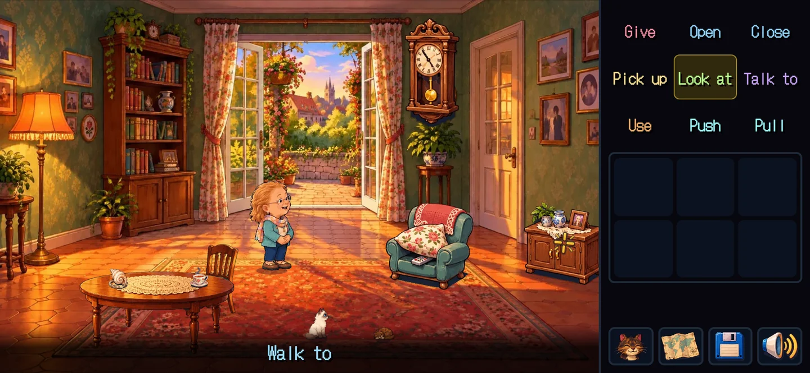
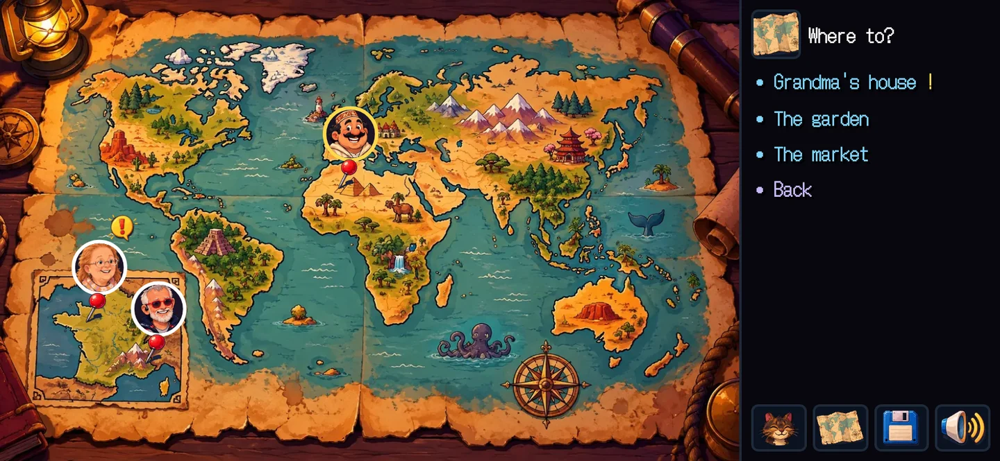
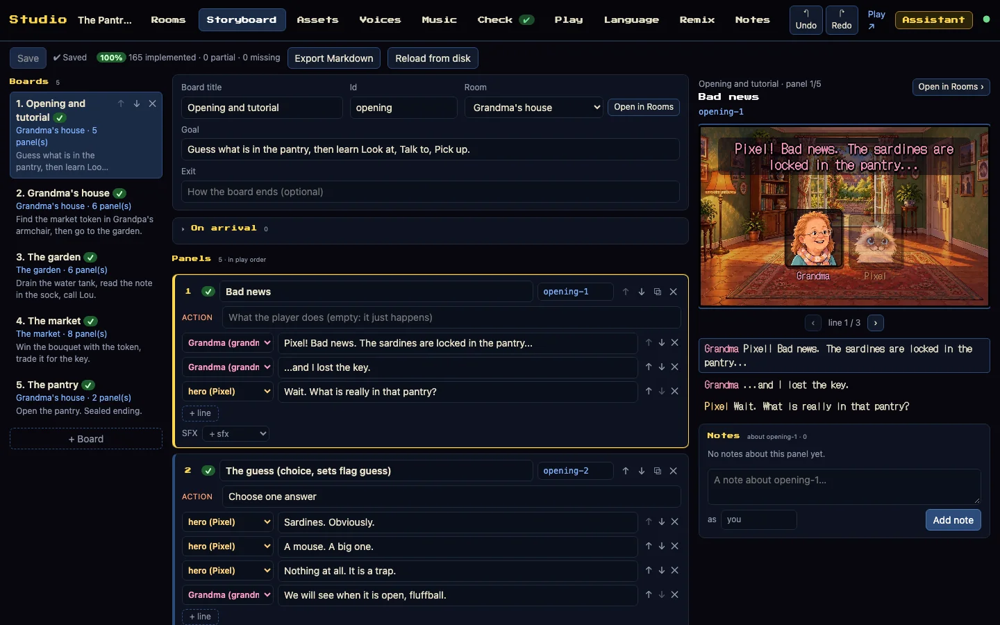
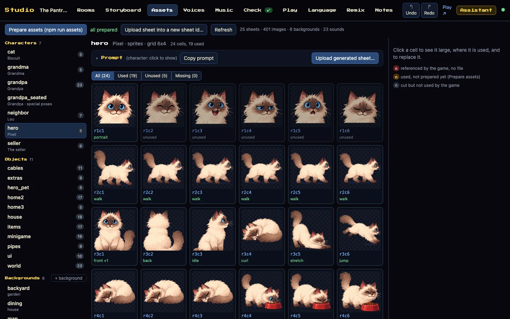
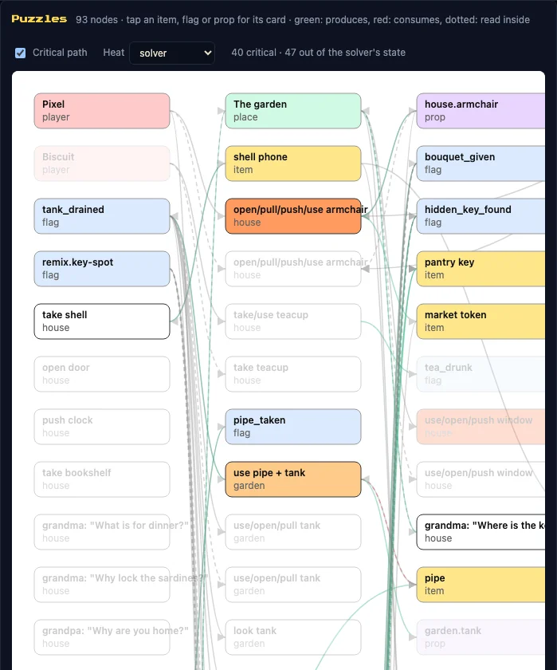

# Galerie

Des captures du jeu d’exemple, *La Clé du garde-manger*, et du Studio local, prises sur le vrai build de production et
le vrai Studio par `npm run docs:screenshots`, jamais des maquettes. Chaque image a ses libellés importants écrits en
dessous. Les captures sont en anglais, la langue de base du jeu.

Ces captures ont été prises à la **4.1.19** (11 octobre 2026). Depuis, la police de l’interface a changé (Galmuri11,
4.3.0), le héros se choisit à la Nouvelle partie (4.3.0), et le Studio a gagné une matrice héros × langue et des
captures avant/après (4.4.0) : rien de cela n’apparaît encore ici. Pour voir la version actuelle, jouez sur
[quest-n-click.cleverapps.io/demo](https://quest-n-click.cleverapps.io/demo/).

<a name="player"></a>

## Le jeu



*Le salon de Grand-mère.* À droite, les verbes **Give, Open, Close, Pick up, Look at, Talk to, Use, Push, Pull**
(« Look at » est choisi), le sac (six cases vides) et quatre outils : l’autre personnage jouable (le chat), la carte, le
menu de pause, le son. Sous la scène, la ligne de phrase : **Walk to**.


*Une conversation.* La colonne de droite montre **Grandma** et ses sujets : **Where is the key?**, **What is for
dinner?**, **Why lock the sardines?**, **Can I have a cuddle?**, **Bye!**



*La carte du monde.* Les personnages sont épinglés là où ils sont ; la colonne demande **Where to?** avec **Grandma’s
house !** (du nouveau là-bas), **The garden**, **The market** et **Back**.


*Un mini-jeu, les tuyaux.* La consigne, de Grand-mère au téléphone-coquillage : **Tap a pipe to turn it. Bring the
water to the mushrooms.** Un bouton **Skip** en haut à droite. Il se joue au toucher ou au clavier.

<a name="studio"></a>

## Le Studio


*L’onglet Rooms (Pièces).* Les onglets en haut : **Rooms, Storyboard, Assets, Voices, Music, Check, Play, Language,
Remix, Notes**, puis **Undo**, **Redo**, **Play** et **Assistant**. La salle **Grandma’s house (house)** dans l’éditeur
de placement ; à droite les **Props** (pantry, armchair, clock, table, chair, shell, teacup) et les **Actors** ;
l’accessoire **pantry** choisi, avec ses états **locked** et **open**, ses répliques **Look** et ses **Reactions**.


*L’onglet Check (Vérifier).* **Validator: no error, 0 warning(s)**. **Solver: solved: the ending is reached (35 states
explored; --prove checks every state)**, avec ses quinze étapes, de « (tutorial) Look at pantry » à « Use key with
pantry ». **Solver health** (passes, actions sautées, ce qui sépare les états). **World** : les trois salles et leurs
sorties.



*L’onglet Storyboard.* **100 % — 165 implemented, 0 partial, 0 missing.** Cinq planches : **Opening and tutorial**,
**Grandma’s house**, **The garden**, **The market**, **The pantry**. La case 1, **Bad news**, avec les répliques de
Grand-mère et de Pixel ; à droite l’aperçu de la case et ses notes.



*L’onglet Assets.* **Prepare assets (npm run assets)**, **all prepared**, **25 sheets, 401 images, 6 backgrounds, 23
sounds**. La planche **hero** (Pixel, une grille de 6 × 4, 24 cases, 19 utilisées) : chaque case étiquetée
**portrait**, **walk**, **idle**, **curl**… ou **unused** ; **Copy prompt** et **Upload generated sheet…**.



*Le graphe des énigmes* (onglet Check). **93 nodes** ; les flèches vertes produisent, les rouges consomment. **Critical
path** activé : **40 critical, 47 out of the solver’s state** ; des nœuds comme **tank_drained**, **shell phone**,
**use pipe + tank**, **pantry key**.

<a name="not-shown"></a>

## Pas encore montré

Aucune capture ici ne montre ces écrans, chacun l’étape décisive d’un parcours récent :

| Écran | Depuis | Où le voir aujourd’hui |
|---|---|---|
| Le choix du héros à la Nouvelle partie, en deux langues (`games/heroes`) | 4.3.0 | [Choisir son héros](create.heroes.md) |
| L’onglet Voices du Studio, la matrice « Heroes × languages » | 4.4.0 | [La matrice héros × langue](studio.voices-matrix.md) |
| Les captures avant/après du diff sémantique (Studio local) | 4.4.0 | le Studio local |
| Un Studio hébergé : la modification d’un membre refusée par un 423, la prévisualisation hébergée, l’onglet Check après un enregistrement | 4.2.x | [423 sur le Studio hébergé](team.write-refused-423.md) |

`npm run docs:screenshots` ne sait pas les prendre tel quel : il joue le jeu d’exemple, *La Clé du garde-manger*, et
ouvre quatre onglets du Studio local sur lui ; il n’a aucune étape pour `games/heroes`, pour l’onglet Voices ni pour un
Studio hébergé. Les prendre demande d’ajouter ces étapes au script, puis de placer chaque capture dans la page de son
parcours.

<a name="regenerate"></a>

## Les reprendre

```sh
# dans le dépôt du moteur, après npm ci et npx playwright install chromium
npm run docs:screenshots
```

Le script construit le jeu dans `.cache/docs-dist`, joue le jeu d’exemple par le harnais de bout en bout et pilote le
Studio avec Playwright, puis écrit des fichiers WebP nommés d’après la release qui les a pris (`4119-<nom>.webp` à la
4.1.19) ; les captures d’une release n’écrasent jamais celles d’une autre. `--only=game|studio` n’en prend qu’une
moitié ; `--keep-png` garde les captures brutes. Le script : [`scripts/docs-screenshots.mjs`](../../scripts/docs-screenshots.mjs).
